  

I’m a **Senior Software Engineer at Octacer**. My primary stack is **C#, .NET, ASP.NET Core, and SQL Server**. I build backend systems and APIs, supported by React and React Native interfaces and business integrations. My work spans SaaS platforms, document workflows, CRM integrations, and real-time applications.

**Five years of professional experience** across Octacer and MyConstruction.

## Selected engineering work

Selected case studies covering product development, real-time systems, and connected business workflows.

<table>
<tr><td width="50%" valign="top">
.NET / Operational workflows
<h3>Construction operations</h3>
Give site supervisors one place for project updates, tasks, materials and team information.

<strong>Technical focus</strong> Project context and domain coordination

<code>C#</code> &nbsp; <code>ASP.NET Core</code> &nbsp; <code>Entity Framework</code>

<a href="case-studies/construction-project-operations-platform.md">Explore case study →</a>
</td><td width="50%" valign="top">
ASP.NET / Real-time systems
<h3>Chess learning platform</h3>
Match puzzles to player ability and connect web and mobile practice to realtime chess analysis.

<strong>Technical focus</strong> Analysis sessions and connection lifecycle

<code>ASP.NET</code> &nbsp; <code>SignalR</code> &nbsp; <code>React Native</code>

<a href="case-studies/cross-platform-chess-learning-platform.md">Explore case study →</a>
</td></tr>
<tr><td width="50%" valign="top">
SaaS / CRM integrations
<h3>Sales performance SaaS</h3>
Connect sales activity to team challenges and rewards, with separate workspaces and subscription controls.

<strong>Technical focus</strong> Workspace boundaries and subscription state

<code>React</code> &nbsp; <code>TypeScript</code> &nbsp; <code>PostgreSQL</code>

<a href="case-studies/sales-performance-and-crm-gamification-platform.md">Explore case study →</a>
</td><td width="50%" valign="top">
Document processing / Background jobs
<h3>Document intake &amp; review</h3>
Turn scanned documents into records staff can review. Keep background failures visible and recoverable.

<strong>Technical focus</strong> Processing failures and human review

<code>Next.js</code> &nbsp; <code>PostgreSQL</code> &nbsp; <code>pg-boss</code>

<a href="case-studies/document-intake-and-legal-workflow-platform.md">Explore case study →</a>
</td></tr>
</table>

## Engineering focus

**Connected systems.** CRM, contracts, payments, and onboarding need consistent state across services. The CRM case study explores event deduplication and checks before a workflow advances.

**Recoverable workflows.** Background processing needs visible failures and a path to recovery. The document intake case study covers processing errors and staff review.

**Real-time experiences.** Interactive features need to account for connection lifecycles. The chess case study explores authenticated analysis sessions and cancellation when a client disconnects.

## Technologies

**Primary stack: C# · .NET · ASP.NET Core · SQL Server.**

Supporting technologies span web, mobile, data, and integrations.

<table>
<tr><td><strong>.NET backend</strong> Primary stack</td><td> <strong>C# · .NET · ASP.NET Core</strong> Entity Framework · SignalR</td></tr>
<tr><td><strong>Data & persistence</strong> SQL Server first</td><td><strong>SQL Server</strong> PostgreSQL · Supabase Entity Framework · Drizzle · pg-boss</td></tr>
<tr><td><strong>Web & mobile</strong> Product interfaces</td><td> TypeScript · React · Next.js React Native · Expo</td></tr>
<tr><td><strong>Automation & integrations</strong> Connected workflows</td><td>Node.js · n8n · HubSpot · Salesforce Stripe · DocuSign</td></tr>
</table>

## Experience

**Octacer · Senior Software Engineer**  
3 years

**MyConstruction**  
2 years

## More project work

[CRM & onboarding](case-studies/coaching-crm-and-onboarding-automation.md) · [Creator collaboration marketplace](case-studies/creator-collaboration-marketplace.md)

Client work is presented through code-free case studies. Each describes the project’s technical scope; individual responsibilities and outcomes are being confirmed for the final version.

---

[Explore my public repositories ↗](https://github.com/anas-asghar4831?tab=repositories)
