[← All projects](../README.md)

# CRM-to-onboarding automation

Connect booking, contracts, payment events and onboarding.

<table>
<tr><td><strong>Format</strong></td><td>Engineering case study · Code-free</td></tr>
<tr><td><strong>Technology</strong></td><td>n8n, HubSpot, Stripe, DocuSign, Gmail, JavaScript.</td></tr>
</table>

## Context

Booking, sales, contracts and billing are separate systems. Their events need to be reconciled before a customer progresses to onboarding.

## Project scope

A CRM automation system connects bookings with deals, contract signing and payment events. Guarded subworkflows synchronize lifecycle stages and start onboarding when prerequisite events are satisfied.

## Workflow at a glance

Booking event → CRM deal → Contract and payment checks → Onboarding gate

Simplified workflow for this case study. Client architecture and operational details are omitted.

## Implementation highlights

- Booking-to-deal deduplication
- Contract status synchronization
- Invoice and subscription flows
- Payment stage updates
- Onboarding gates

## Technology

n8n, HubSpot, Stripe, DocuSign, Gmail, JavaScript.

## Engineering considerations

### Event reconciliation

The reviewed orchestrator classifies and deduplicates webhook events before routing them to subworkflows.

### Readiness gates

Onboarding checks prerequisites before progressing the contact and deal and sending a welcome message. Payment events have their own status-update and recurring-plan branches. Historical documentation includes mixed live, demo and parked workflows; a uniform production status is not claimed.

## Contribution and outcomes

Selected from my project work. This draft describes the implementation at project level; the precise responsibilities I held are being documented. It makes no quantified impact, production-status or sole-authorship claim.

Client identity, proprietary source code, internal URLs and operational data are omitted.

---

[Back to profile](../README.md)
