[← All projects](../README.md)

# Construction operations

Bring site updates and project resources into a supervisor workflow.

<table>
<tr><td><strong>Format</strong></td><td>Engineering case study · Code-free</td></tr>
<tr><td><strong>Technology</strong></td><td>C#, ASP.NET Core MVC, Cofoundry, Entity Framework.</td></tr>
</table>

## Context

Site supervisors need project context while recording updates. Tasks, materials, contractors and teams need to remain connected to the relevant project.

## Project scope

A construction operations platform connects site supervision with project information, tasks and resources. Its supervisor workflow loads project context for site updates and ties together materials, contractors, teams and quality-related data. The strongest case study will focus on the specific operational workflows personally implemented.

## Workflow at a glance

Supervisor project view → Site updates → Tasks, materials and team context

Simplified workflow for this case study. Client architecture and operational details are omitted.

## Implementation highlights

- Supervisor project views
- Site update workflow
- Project tasks and materials
- Contractor, team and quality domain integrations

## Technology

C#, ASP.NET Core MVC, Cofoundry, Entity Framework.

## Engineering considerations

### Access and project context

The reviewed supervisor controller authorizes the supervisor area, resolves the current user and loads the project needed for a site update.

### Domain coordination

Tasks, materials, teams and quality-related providers supply the surrounding project context. This case is strongest as an operational workflow example; broader platform ownership remains to be documented.

## Contribution and outcomes

Selected from my project work. This draft describes the implementation at project level; the precise responsibilities I held are being documented. It makes no quantified impact, production-status or sole-authorship claim.

Client identity, proprietary source code, internal URLs and operational data are omitted.

---

[Back to profile](../README.md)
