[← All projects](../README.md)

# Creator collaboration marketplace

Coordinate creator jobs, submissions, reviews and payment release.

<table>
<tr><td><strong>Format</strong></td><td>Engineering case study · Code-free</td></tr>
<tr><td><strong>Technology</strong></td><td>React, TypeScript, Vite, Supabase, Stripe.</td></tr>
</table>

## Context

Brands and creators need a shared place to manage deliverables and revisions, with review state tied to the payment-release workflow.

## Project scope

A collaboration workspace connects creator discovery with job execution. Submission, review and payment-release interactions keep work and approval steps together.

## Workflow at a glance

Creator discovery → Job workspace → Deliverable and revision → Review → Payment release

Simplified workflow for this case study. Client architecture and operational details are omitted.

## Implementation highlights

- Creator discovery
- Job workspaces
- Deliverable resubmission
- Reviews
- Payment release

## Technology

React, TypeScript, Vite, Supabase, Stripe.

## Engineering considerations

### State continuity

The reviewed job workspace loads persisted deliverables and reviews. Resubmission can reuse existing delivery links rather than discarding prior context.

### Review and payment interactions

Submission moves the job into review, while the workspace handles the payment-release response separately. These are observed application interactions, not a claim that payment correctness or production behaviour has been independently tested.

## Contribution and outcomes

Selected from my project work. This draft describes the implementation at project level; the precise responsibilities I held are being documented. It makes no quantified impact, production-status or sole-authorship claim.

Client identity, proprietary source code, internal URLs and operational data are omitted.

---

[Back to profile](../README.md)
