[← All projects](../README.md)

# Chess learning across web & mobile

Connect puzzle practice with rating-aware selection and realtime analysis.

<table>
<tr><td><strong>Format</strong></td><td>Engineering case study · Code-free</td></tr>
<tr><td><strong>Technology</strong></td><td>Next.js, React, Expo, React Native, ASP.NET, Entity Framework, SignalR, Stockfish.</td></tr>
</table>

## Context

A learning product must coordinate puzzle difficulty, game state and engine sessions across web and mobile clients.

## Project scope

A chess learning platform combines web and mobile practice with server-side puzzle selection. Rating constraints shape puzzle difficulty, and realtime engine sessions provide analysis through a shared backend.

## Workflow at a glance

Web and mobile practice → Puzzle selection and sessions → Realtime engine analysis

Simplified workflow for this case study. Client architecture and operational details are omitted.

## Implementation highlights

- Difficulty-based puzzle selection
- User rating constraints
- Mobile puzzle sessions
- Realtime engine requests
- Opening and lesson modules

## Technology

Next.js, React, Expo, React Native, ASP.NET, Entity Framework, SignalR, Stockfish.

## Engineering considerations

### Session lifecycle

The reviewed analysis hub authenticates requests and cancels active engine sessions when a client disconnects.

### Difficulty and client state

Puzzle selection intersects difficulty rules with user-rating constraints. The mobile flow coordinates puzzle sessions and board/review state, including failed-save state. Earlier migration checkouts are not treated as evidence of completed functionality.

## Contribution and outcomes

Selected from my project work. This draft describes the implementation at project level; the precise responsibilities I held are being documented. It makes no quantified impact, production-status or sole-authorship claim.

Client identity, proprietary source code, internal URLs and operational data are omitted.

---

[Back to profile](../README.md)
