[← All projects](../README.md)

# Document intake & review

Turn scanned packets into structured, reviewable intake records.

<table>
<tr><td><strong>Format</strong></td><td>Engineering case study · Code-free</td></tr>
<tr><td><strong>Technology</strong></td><td>Next.js, TypeScript, React, PostgreSQL, Drizzle, pg-boss.</td></tr>
</table>

## Context

Document-heavy intake needs a clear path from an uploaded packet to reviewed records. Background processing must expose failures so staff can recover incomplete work.

## Project scope

An internal platform turns scanned legal packets into reviewable structured intake records. The reviewed implementation includes packet review, case creation, generated intake documents, background synchronization, recoverable per-group failures. Deployment and outcomes have not been independently verified.

## Workflow at a glance

Scanned packets → Staff review → Intake and case records → Background synchronization

Simplified workflow for this case study. Client architecture and operational details are omitted.

## Implementation highlights

- Packet review
- Case creation
- Generated intake documents
- Background synchronization
- Recoverable per-group failures

## Technology

Next.js, TypeScript, React, PostgreSQL, Drizzle, pg-boss.

## Engineering considerations

### Human review

The workflow turns scanned packets into records staff can review; extraction alone is not the final intake step.

### Recoverable background work

The reviewed worker creates intake, case and document records, queues synchronization, and preserves per-group errors and failed status for recovery. This is the strongest evidence-backed reliability aspect of the project.

## Contribution and outcomes

Selected from my project work. This draft describes the implementation at project level; the precise responsibilities I held are being documented. It makes no quantified impact, production-status or sole-authorship claim.

Client identity, proprietary source code, internal URLs and operational data are omitted.

---

[Back to profile](../README.md)
