[← All projects](../README.md)

# Sales performance & CRM gamification

Connect sales activity with challenges, rewards and subscription management.

<table>
<tr><td><strong>Format</strong></td><td>Engineering case study · Code-free</td></tr>
<tr><td><strong>Technology</strong></td><td>React, TypeScript, Express, Drizzle ORM, PostgreSQL, Stripe, HubSpot, Salesforce.</td></tr>
</table>

## Context

Managers need a shared view of CRM activity, team goals and reward approvals. Those workflows also have to respect workspace and subscription boundaries.

## Project scope

A sales performance platform connects CRM activity with team challenges, progress dashboards and reward workflows. Its web application brings together CRM integration, reward approvals and subscription seat management, giving managers a shared place to coordinate sales incentives.

## Workflow at a glance

CRM integrations → Workspace activity → Challenges and progress → Reward review

Simplified workflow for this case study. Client architecture and operational details are omitted.

## Implementation highlights

- Workspace-based CRM integration flows
- Sales challenges and progress analytics
- Reward catalogue and redemption approvals
- Subscription and seat management

## Technology

React, TypeScript, Express, Drizzle ORM, PostgreSQL, Stripe, HubSpot, Salesforce.

## Engineering considerations

### Integration boundaries

CRM connections operate within workspace workflows. Connection handling, reward balances and billing-seat allocation are separate concerns in the reviewed implementation.

### Approval and billing state

Reward redemption and subscription-seat management introduce distinct state transitions. The case study focuses on those workflows rather than claiming a measured increase in sales.

## Contribution and outcomes

Selected from my project work. This draft describes the implementation at project level; the precise responsibilities I held are being documented. It makes no quantified impact, production-status or sole-authorship claim.

Client identity, proprietary source code, internal URLs and operational data are omitted.

---

[Back to profile](../README.md)
